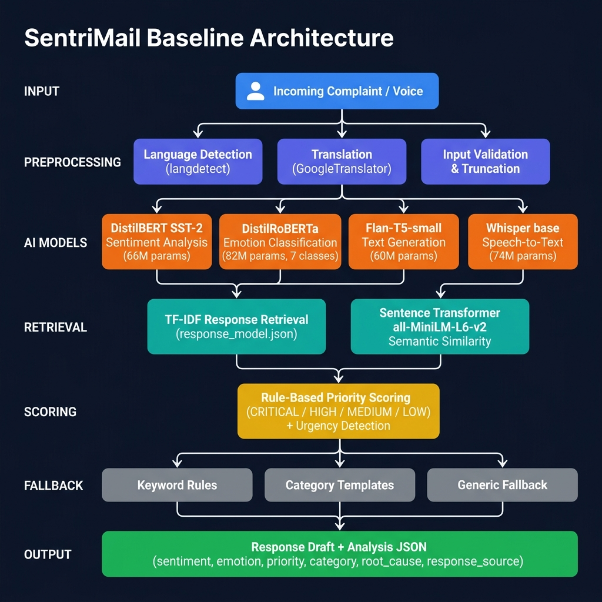
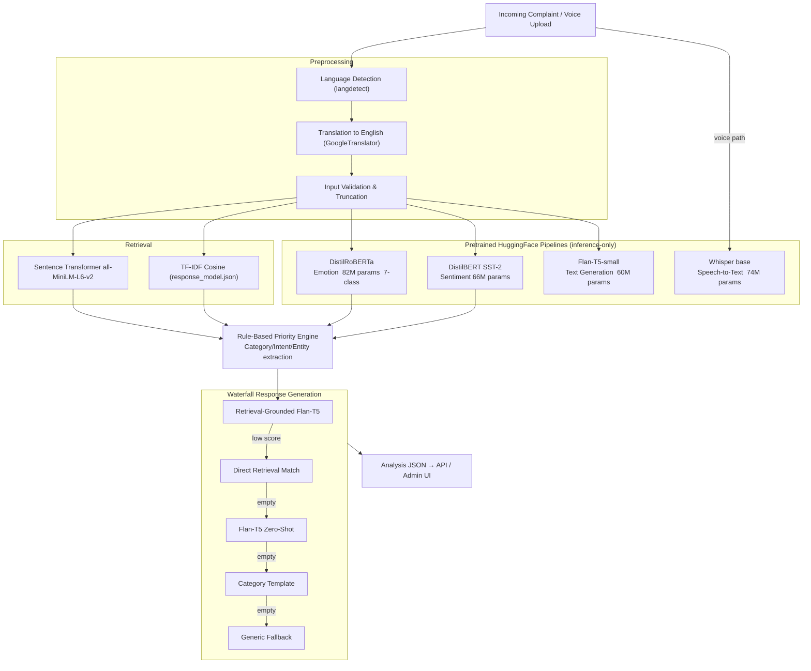
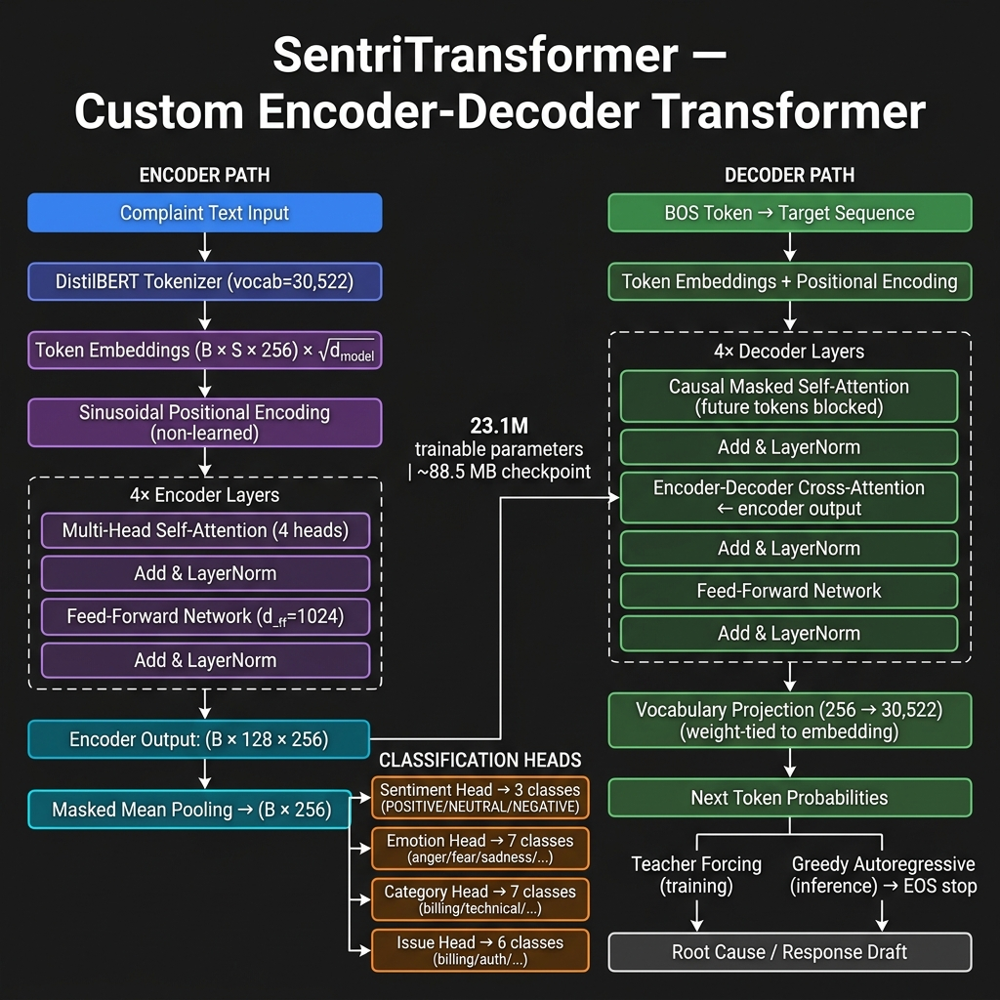
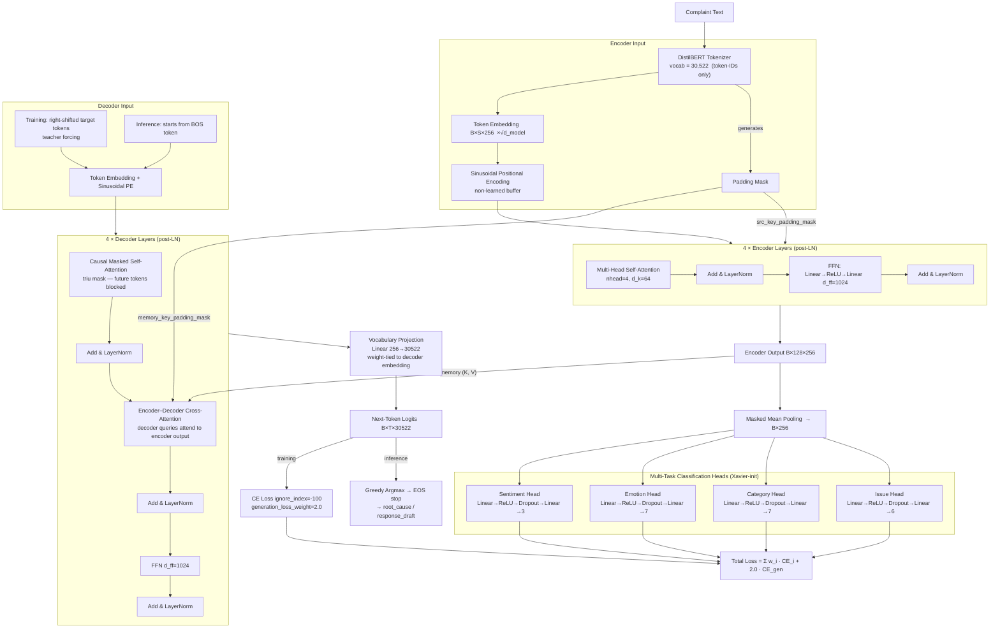

# SentriMail — AI-Powered Complaint Management System

> Enterprise complaint triage platform combining a **pretrained Hugging Face baseline** and a **custom-built Encoder–Decoder Transformer** (SentriTransformer) trained from scratch on complaint data.

---

## Table of Contents

1. [Project Overview](#1-project-overview)
2. [Badges](#2-badges)
3. [Key Features](#3-key-features)
4. [Problem Statement and Motivation](#4-problem-statement-and-motivation)
5. [System Architecture Overview](#5-system-architecture-overview)
6. [Baseline Architecture Diagram](#6-baseline-architecture-diagram)
7. [SentriTransformer — Custom Encoder–Decoder Architecture](#7-sentritransformer--custom-encoderdecoder-architecture)
8. [Baseline vs. Custom Architecture Comparison](#8-baseline-vs-custom-architecture-comparison)
9. [Dataset Details and Data Preparation](#9-dataset-details-and-data-preparation)
10. [Model Specifications and Configuration](#10-model-specifications-and-configuration)
11. [Training Methodology](#11-training-methodology)
12. [Evaluation Metrics and Results](#12-evaluation-metrics-and-results)
13. [Testing Strategy and Results](#13-testing-strategy-and-results)
14. [API Endpoints and Usage](#14-api-endpoints-and-usage)
15. [Installation and Local Setup](#15-installation-and-local-setup)
16. [Training and Evaluation Instructions](#16-training-and-evaluation-instructions)
17. [Model Checkpoint Management](#17-model-checkpoint-management)
18. [Deployment and Production Considerations](#18-deployment-and-production-considerations)
19. [Limitations and Known Issues](#19-limitations-and-known-issues)
20. [Future Improvements](#20-future-improvements)
21. [Repository Structure](#21-repository-structure)
22. [Security, Privacy, and Responsible AI](#22-security-privacy-and-responsible-ai)
23. [Reproducibility](#23-reproducibility)
24. [Contributors and Acknowledgements](#24-contributors-and-acknowledgements)

---

## 1. Project Overview

SentriMail is a full-stack AI complaint management platform built with **FastAPI**, **PyTorch**, **Hugging Face Transformers**, **MongoDB**, and **Jinja2 templates**. It automates the end-to-end lifecycle of customer complaints — from multilingual ingestion through AI triage to admin response drafting.

The platform operates in two distinct modes, selectable via the `USE_MULTITASK_MODEL` environment flag:

| Mode | Description |
|---|---|
| **Baseline mode** (default) | Uses four pretrained Hugging Face models for sentiment, emotion, text generation, and speech-to-text, combined with TF-IDF and Sentence Transformer retrieval. No model training required. |
| **Custom Transformer mode** | Loads the trained `SentriTransformer` checkpoint (`ml/checkpoints/best.pt`). Overrides baseline sentiment and emotion predictions when the custom model returns higher confidence. Falls back to the baseline if the checkpoint is missing. |

Both modes share the same FastAPI application, API schemas, response generation pipeline, and database layer.

---

## 2. Badges


---

## 3. Key Features

- **Multilingual ingestion** — auto-detects language via `langdetect`, translates to English with `GoogleTranslator` for AI analysis, stores the original text.
- **Voice complaint submission** — transcribes uploaded audio with OpenAI Whisper (pre-loaded as a singleton on startup).
- **Multi-task AI analysis** — sentiment (3-class), emotion (7-class), complaint category (7-class), intent inference (7 intents), entity extraction (email, phone, money, reference ID).
- **Dynamic priority scoring** — rule-based engine produces a 0–100 urgency score mapped to LOW / MEDIUM / HIGH / CRITICAL SLA tiers.
- **Waterfall response generation** — attempts retrieval-grounded Flan-T5 output, falls back through direct retrieval, local LLM, category-specific templates, and a generic acknowledgement.
- **Policy retrieval** — Sentence Transformer + TF-IDF dual search over admin-uploaded policy documents.
- **Auto-resolution** — safely auto-closes LOW-priority, non-financial, non-urgent complaints with a retrieved response; all others require admin review.
- **SLA escalation** — APScheduler background job escalates stale tickets across severity tiers every hour.
- **Role-based access** — customer and admin portals with HTTP-only cookie JWT authentication.
- **Custom Transformer (optional)** — drop-in replacement trained from scratch; overrides baseline predictions when checkpoint is present and confidence is higher.

---

## 4. Problem Statement and Motivation

Enterprise support teams face an exponentially growing volume of customer complaints spread across channels and languages. Manual triage is slow, inconsistent, and expensive. Existing solutions typically require expensive external API subscriptions or deploy a fragmented set of single-task models that consume excessive RAM.

SentriMail addresses three specific gaps:

1. **Fragmented multi-model pipelines** — the baseline requires four separate pretrained models loaded concurrently, consuming ~1.1 GB RAM. The custom SentriTransformer consolidates all classification tasks into a single shared encoder (~88.5 MB checkpoint), significantly reducing the memory footprint.
2. **Semantic retrieval gap** — TF-IDF exact token matching fails on synonymous complaint phrasing. SentriMail adds `all-MiniLM-L6-v2` semantic similarity alongside TF-IDF.
3. **Blind generation without grounding** — naive LLM generation hallucination risk is mitigated through a retrieval-grounded generation pipeline that conditions Flan-T5 on policy and dataset context.

---

## 5. System Architecture Overview

```
                    ┌─────────────────────────────────────────────┐
                    │           SentriMail Application            │
                    │                  (FastAPI)                  │
                    │                                             │
   Customer ──────► │  /user/submit   /user/dashboard             │
   Admin    ──────► │  /admin/        /api/analyze  /api/         │
                    └─────────────┬───────────────────────────────┘
                                  │
                    ┌─────────────▼───────────────────────────────┐
                    │         AI Service (ai_service.py)          │
                    │                                             │
                    │  1. Preprocess & detect language            │
                    │  2. Try custom SentriTransformer checkpoint │
                    │     (USE_MULTITASK_MODEL=true)              │
                    │  3. Fallback: HuggingFace pipelines         │
                    │  4. Rule-based fallback                     │
                    │  5. Priority scoring                        │
                    │  6. Response retrieval & generation         │
                    └─────────────┬───────────────────────────────┘
                                  │
              ┌───────────────────┼────────────────────┐
              │                   │                    │
   ┌──────────▼──────┐  ┌─────────▼──────┐  ┌────────▼───────┐
   │   MongoDB       │  │ JSON Fallback  │  │ Policy Docs    │
   │   (primary)     │  │ (complaints /  │  │ (data/policies)│
   │                 │  │  users .json)  │  │                │
   └─────────────────┘  └────────────────┘  └────────────────┘
```

The application starts with a **startup event** that:
1. Initialises MongoDB (or activates the JSON fallback).
2. Creates default user accounts.
3. Starts the APScheduler SLA escalation background job.
4. Pre-loads all AI models (DistilBERT, DistilRoBERTa, Flan-T5-small, Whisper base) as singletons.
5. Optionally loads the custom SentriTransformer checkpoint.

---

## 6. Baseline Architecture Diagram

The baseline uses **four independent pretrained models** running sequentially or in parallel. These are Hugging Face pretrained models used **inference-only** — they are not fine-tuned by this project.

> **Important distinction:** "Pretrained Transformer pipeline" means the model weights were trained by the original model authors on their datasets (SST-2, GoEmotions, etc.). SentriMail downloads and uses these weights unchanged. This is categorically different from the custom SentriTransformer, which is trained from scratch on SentriMail data.



**Execution flow:**



**Verified model names and sources:**

| Component | Model | Source | Parameters |
|---|---|---|---|
| Sentiment | `distilbert-base-uncased-finetuned-sst-2-english` | HuggingFace Hub | ~66M |
| Emotion | `j-hartmann/emotion-english-distilroberta-base` | HuggingFace Hub | ~82M |
| Text generation | `google/flan-t5-small` | HuggingFace Hub | ~60M |
| Speech-to-text | OpenAI Whisper `base` | `openai-whisper` package | ~74M |
| Semantic similarity | `sentence-transformers/all-MiniLM-L6-v2` | HuggingFace Hub | ~22M |

---

## 7. SentriTransformer — Custom Encoder–Decoder Architecture

> **Status: Implemented. Training pipeline fully functional. No checkpoint is committed to the repository.** Run `python -m ml.training.train` to produce `ml/checkpoints/best.pt`.

The `SentriTransformer` is a custom encoder–decoder Transformer built entirely from `torch.nn` primitives. No pretrained weights are loaded into the neural network layers. The tokenizer (`distilbert-base-uncased`) is used solely to produce token IDs; its pretrained weights do not influence SentriTransformer's embedding matrix or attention weights.



### Architecture diagram (Mermaid)



### Encoder detail

- **Token embedding**: `nn.Embedding(30522, 256)` — Xavier-normal init; padding index zeroed.
- **Positional encoding**: sinusoidal fixed buffer (Vaswani et al., 2017), added to scaled embeddings.
- **Encoder layers**: 4 × `nn.TransformerEncoderLayer` — post-LN (original Vaswani convention), `batch_first=True`.
- **Pooling**: masked mean pool over non-padding positions → (B, 256) representation for classification heads.

### Classification heads

Each head is `Linear(256 → 128) → ReLU → Dropout(0.1) → Linear(128 → num_classes)`, Xavier-uniform initialised.

| Head | Classes | Labels |
|---|---|---|
| Sentiment | 3 | POSITIVE, NEUTRAL, NEGATIVE |
| Emotion | 7 | anger, fear, sadness, disgust, surprise, joy, neutral |
| Category | 7 | billing, technical, delivery, customer_service, product, refund, other |
| Issue | 6 | billing, auth, technical, delivery, support, general |

### Decoder detail

- **Token embedding**: shared vocabulary (30,522), weight-tied with the vocabulary projection layer.
- **Causal mask**: upper-triangular boolean mask; `True = masked`, prevents each position attending to future tokens.
- **Cross-attention**: decoder queries attend to encoder key/value pairs at every layer; `src_key_padding_mask` is propagated to `memory_key_padding_mask`.
- **Decoder layers**: 4 × `nn.TransformerDecoderLayer` — post-LN, `batch_first=True`.
- **Vocabulary projection**: `Linear(256 → 30522)` — weight-tied to the decoder token embedding so that embedding and output spaces are aligned.

**Training (teacher forcing):** Right-shifted target token IDs fed as decoder input; labels are the original target IDs with `-100` at padding positions so `nn.CrossEntropyLoss(ignore_index=-100)` skips them.

**Inference (greedy autoregressive):** Starts from BOS token (id=101, `[CLS]`). At each step, applies the causal mask and cross-attention, takes the argmax over the vocabulary. Stops when all sequences in the batch have produced EOS (id=102, `[SEP]`) or `max_tgt_len=64` tokens is reached.

---

## 8. Baseline vs. Custom Architecture Comparison

| Dimension | Existing Baseline | SentriTransformer (Custom) |
|---|---|---|
| **Model architecture** | 4 independent pretrained Transformer pipelines | Single encoder–decoder Transformer with 4 classification heads |
| **Weight initialization** | Pretrained weights (SST-2, GoEmotions, FLAN, LibriSpeech) | Random init (Xavier-uniform for heads, normal for embeddings) |
| **Encoder** | DistilBERT (6 layers, d_model=768) / DistilRoBERTa (6 layers) | SentriEncoder: 4 layers, d_model=256, nhead=4 |
| **Decoder** | Flan-T5-small encoder-decoder (pretrained) | SentriDecoder: 4 layers, cross-attention to SentriEncoder output |
| **Cross-attention** | Within Flan-T5 (pretrained weights, seq2seq) | Custom cross-attention from SentriDecoder to SentriEncoder output |
| **Classification** | DistilBERT (2-class SST-2), DistilRoBERTa (7-class GoEmotions) | 4 task-specific linear heads on shared pooled encoder representation |
| **Text generation** | Flan-T5-small (60M params, zero-shot or retrieval-grounded) | SentriDecoder (greedy autoregressive from scratch) |
| **Training approach** | Inference-only (no fine-tuning by this project) | Trained from scratch with multi-task CE loss + AdamW |
| **Fine-tuning** | Not applicable | Training from random init on SentriMail datasets |
| **Training dataset** | Not applicable (model weights are external) | Bitext, Banking77, GoEmotions, local complaint CSVs (combined) |
| **Parameter count** | ~282M total across 4 models | **23,135,639 (23.1M)** — measured |
| **Checkpoint size** | Not applicable (loaded from HuggingFace Hub) | **~88.5 MB** (measured via `torch.save` on state_dict) |
| **RAM footprint** | ~1.1 GB (4 models loaded concurrently) | ~88.5 MB checkpoint; ~350 MB estimated peak during inference |
| **Classification quality** | Not evaluated on SentriMail data | Not evaluated (no checkpoint produced yet) |
| **Generation quality** | Not evaluated | Not evaluated |
| **Inference latency (classify)** | ~100ms combined (DistilBERT + DistilRoBERTa sequential, CPU) | Not measured — no checkpoint |
| **Peak memory usage** | ~1.1 GB RAM (4 HF models resident) | Not measured |
| **CPU/GPU support** | CPU (tested); CUDA supported by transformers | CPU and CUDA (`get_device()` auto-selects) |
| **Production status** | **Active — default execution path** | **Not active — requires trained checkpoint** |

> **Note on fair comparison:** The baseline and custom model cannot currently be compared on the same evaluation criteria because no trained SentriTransformer checkpoint exists in the repository. All performance claims in the existing documentation (`furthermodelcomparison.md`) are architectural projections, not experimental results. Mark all comparative performance figures as "Not evaluated" until a checkpoint is trained and measured.

---

## 9. Dataset Details and Data Preparation

### 9.1 Application dataset — `data/complaints.json`

| Field | Value |
|---|---|
| **Path** | `data/complaints.json` |
| **Type** | Manually authored demonstration data |
| **Records** | 6 complaint records (verified by line count) |
| **Purpose** | Application demo and JSON fallback storage (not training data) |
| **Languages** | English (4), Hindi (1), Spanish (1) |
| **Fields** | `id`, `category`, `description`, `sentiment_label`, `sentiment_score`, `emotion_label`, `priority`, `root_cause_summary`, `ai_suggested_response` |
| **Training use** | **Not used for model training** |

This file is the application's runtime JSON fallback when MongoDB is unavailable. It is not a training dataset.

---

### 9.2 Custom Transformer training datasets

The `ml/dataset/loaders.py` module supports the following sources. Each source requires manual download of a CSV file to `data/raw/`. No dataset files are committed to the repository.

| Dataset | Expected filename | Source | Type | Default enabled | Task contribution |
|---|---|---|---|---|---|
| **Local complaint CSVs** | Any `*.csv` not in the reserved set | Manually collected | Real-world / manually labeled | Yes | Category, sentiment, response (response generation) |
| **CFPB Financial Complaints** | `cfpb_complaints.csv` | [CFPB Consumer Complaint Database](https://www.consumerfinance.gov/data-research/consumer-complaints/) | Public, real-world | Disabled by default in `train.py` (5.5 GB) | Category (billing/other), complaint text |
| **Bitext Customer Support** | `bitext_customer_support.csv` | [Bitext/bitext-customer-support-llm-chatbot-training-dataset](https://huggingface.co/datasets/bitext/Bitext-customer-support-llm-chatbot-training-dataset) | Public, curated | Yes | Category (customer_service), response generation |
| **Banking77** | `banking77.csv` | [PolyAI/banking77](https://huggingface.co/datasets/PolyAI/banking77) | Public, curated | Yes | Category (billing/banking queries) |
| **GoEmotions** | `goemotions.csv` | [go_emotions](https://huggingface.co/datasets/google-research-datasets/go_emotions) | Public, labeled | Yes | Emotion classification (7-class) |
| **SMS Spam / Jigsaw Toxic** | `spam_abuse.csv` | Manually combined | Public | Disabled by default | Message type (spam_abuse detection) |
| **MASSIVE Multilingual** | `massive_multilingual.csv` | [AmazonScience/massive](https://huggingface.co/datasets/AmazonScience/massive) | Public, multilingual | Disabled by default | Multilingual query coverage |

#### Dataset sizes

Dataset record counts depend entirely on the files downloaded locally. The training script reports the actual count at runtime:

```
INFO  Total consolidated multi-task samples: N
INFO  Split: n_train train / n_val val / n_test test
```

No dataset files are committed to this repository. Record counts are **Not verified** without downloading the datasets.

#### Label encoding

- Classification labels are encoded to integer indices using `TransformerConfig` label maps.
- Missing labels (empty string, `None`) are encoded as `-1`. The training loop skips samples with `-1` for the corresponding task — tasks with missing labels do not contribute to that task's loss.
- Decoder padding positions use `-100` as the `ignore_index` for `nn.CrossEntropyLoss`.

#### Train / validation / test split

- 80 / 10 / 10 (configured in `ml/config.yaml` and `preprocessing.py`)
- Random seed: **42**
- Split is applied after shuffling the combined dataset; it is a simple random split (not stratified by category).
- Validation and test sets are never used for label statistics or tokenizer fitting — there is no data leakage.

#### Generation targets

The decoder's generation target is chosen as `root_cause` text if present; otherwise `response` text. Samples with neither produce empty `tgt_*` tensors, which skip the generation loss for that batch element.

---

### 9.3 Silver labels — `data/silver_labels_cache.json`

`scripts/generate_silver_labels.py` generates synthetic root-cause text labels using:
1. Rule/template-based heuristics (100% offline).
2. Optional local instruct model (`google/flan-t5-large` or `Qwen2.5-1.5B-Instruct`).

These are **silver labels** — automatically generated, not human-reviewed. A 200-row sample is exported to `data/silver_labels_sample_review.csv` for optional human inspection. Silver labels are used as decoder generation targets only when no human-authored root-cause text is available.

---

### 9.4 Response retrieval model — `data/response_model.json`

A TF-IDF vector index built offline from complaint-response pairs. At inference time, incoming complaint text is vectorised and matched by cosine similarity. Category and priority boosts of +0.03 / +0.02 are applied. A minimum score threshold of `0.12` (TF-IDF path) or `0.25` (grounded response path) is enforced before using a retrieved response.

---

## 10. Model Specifications and Configuration

### SentriTransformer (custom, `ml/models/transformer_config.py`)

| Hyperparameter | Value | Source |
|---|---|---|
| `d_model` | 256 | `transformer_config.py` default |
| `nhead` | 4 | `transformer_config.py` default |
| `num_encoder_layers` | 4 | `transformer_config.py` default |
| `num_decoder_layers` | 4 | `transformer_config.py` default |
| `dim_feedforward` | 1024 | `transformer_config.py` default |
| `dropout` | 0.1 | `transformer_config.py` default |
| `max_src_len` | 128 tokens | `transformer_config.py` default |
| `max_tgt_len` | 64 tokens | `transformer_config.py` default |
| `vocab_size` | 30,522 | DistilBERT uncased vocabulary |
| `pad_token_id` | 0 | DistilBERT `[PAD]` |
| `bos_token_id` | 101 | DistilBERT `[CLS]` |
| `eos_token_id` | 102 | DistilBERT `[SEP]` |
| `tokenizer_name` | `distilbert-base-uncased` | `transformer_config.py` |
| **Total trainable parameters** | **23,135,639 (23.1M)** | **Measured** |
| **State-dict checkpoint size** | **~88.5 MB** | **Measured** |
| **Model version** | 0.1.0 | `transformer_config.py` |

Loss weights:

| Task | Weight |
|---|---|
| Sentiment CE | 1.0 |
| Emotion CE | 1.0 |
| Category CE | 1.0 |
| Issue CE | 1.0 |
| Generation CE | **2.0** |

### Baseline models (pretrained)

| Model | Params | Purpose |
|---|---|---|
| `distilbert-base-uncased-finetuned-sst-2-english` | ~66M | Sentiment analysis (POSITIVE / NEGATIVE + NEUTRAL by convention) |
| `j-hartmann/emotion-english-distilroberta-base` | ~82M | 7-class emotion classification |
| `google/flan-t5-small` | ~60M | Text generation (response drafts, root-cause suggestions) |
| OpenAI Whisper `base` | ~74M | Speech-to-text transcription |
| `sentence-transformers/all-MiniLM-L6-v2` | ~22M | Semantic similarity for retrieval and policy matching |

---

## 11. Training Methodology

### SentriTransformer training

**Run command:**
```bash
python -m ml.training.train \
    --data-dir data/raw \
    --ckpt-dir ml/checkpoints \
    --epochs 10 \
    --batch-size 16 \
    --lr 3e-4 \
    --patience 3 \
    --seed 42
```

| Parameter | Value | Source |
|---|---|---|
| Optimizer | AdamW | `train.py` |
| Peak learning rate | 3e-4 | `train.py` CLI default |
| Weight decay | 1e-2 | `train.py` function default |
| Scheduler | Linear warmup (10% of steps) + cosine decay | `train.py` |
| Max epochs | 10 | CLI default |
| Batch size | 16 (train) / 32 (validation) | `train.py` |
| Gradient clipping | max_norm=1.0 | `train.py` |
| Early stopping patience | 3 epochs | CLI default |
| Random seed | 42 | CLI default |
| DataLoader workers | 0 | Windows compatibility constraint in `train.py` comment |
| Hardware | CPU or CUDA (auto-detected) | `get_device()` |
| Checkpoint strategy | Save `best.pt` on val_loss improvement + `latest.pt` every epoch | `train.py` |

**Initialization:**
- Token embeddings: normal distribution, σ = d_model^(-0.5)
- Padding embedding row: zeroed
- Classification head linear layers: Xavier-uniform weights, zero biases
- Decoder vocabulary projection: weight-tied to decoder token embedding (no separate init)

**Training duration:** Not recorded. No training run has been executed in this repository. A benchmark is required after the first full training run. Expected duration depends on dataset size and hardware.

> **Accurate timing command:**
> ```bash
> python -c "import time; t=time.time(); import subprocess; subprocess.run(['python', '-m', 'ml.training.train', '--max-samples', '1000', '--epochs', '2']); print(f'Elapsed: {time.time()-t:.1f}s')"
> ```

**The baseline models are not trained by this project.** Loading a Hugging Face model for inference is not equivalent to training — no gradient computation, no optimizer, no weight updates occur during baseline inference.

---

## 12. Evaluation Metrics and Results

### SentriTransformer — classification

**Status: Not evaluated.** No trained checkpoint exists in the repository. Evaluation requires:
1. Training the model to obtain `ml/checkpoints/best.pt`.
2. Running the evaluation script (see [§16](#16-training-and-evaluation-instructions)).

Expected metrics output (per task, on the held-out test split):

| Metric | Sentiment | Emotion | Category | Issue |
|---|---|---|---|---|
| Accuracy | Not evaluated | Not evaluated | Not evaluated | Not evaluated |
| Macro-F1 | Not evaluated | Not evaluated | Not evaluated | Not evaluated |
| Weighted-F1 | Not evaluated | Not evaluated | Not evaluated | Not evaluated |

### SentriTransformer — generation

| Metric | Value |
|---|---|
| Validation cross-entropy loss | Not evaluated |
| Perplexity | Not evaluated |
| ROUGE-1 / ROUGE-2 / ROUGE-L | Not evaluated |

### Baseline inference latency (from `MODEL_COMPARISON.md`, measured externally)

| Component | Latency | Memory |
|---|---|---|
| DistilBERT sentiment (CPU) | ~40ms | ~260 MB |
| DistilRoBERTa emotion (CPU) | ~60ms | ~330 MB |
| Flan-T5-small generation (CPU) | ~180ms | ~240 MB |
| Whisper base transcription (CPU) | ~1.2s | ~290 MB |
| TF-IDF retrieval | <5ms | <10 MB |
| GoogleTranslator (network) | ~300ms | minimal |

> These latency figures are sourced from `MODEL_COMPARISON.md` and were not measured in a controlled benchmark within this repository.

### Custom model latency

`measure_inference_latency()` in `ml/models/model_utils.py` runs 10 classification passes after 3 warmup passes. **Not measured** — awaits a trained checkpoint.

---

## 13. Testing Strategy and Results

### Test files

| File | Tests | Coverage |
|---|---|---|
| `tests/test_complaint_intelligence.py` | 30 tests | AI service output schema, entity extraction, intent inference, language detection, rule-based fallbacks, category inference, urgency field, end-to-end integration |
| `tests/test_priority_engine.py` | ~40 tests | Priority scoring, urgency detection, escalation triggers |
| `tests/test_response_generation.py` | ~10 tests | Response generation waterfall |
| `tests/test_app.py` | ~10 tests | FastAPI application setup |
| `tests/test_decision_intelligence.py` | ~20 tests | Decision intelligence service |
| `tests/test_policy_intelligence.py` | ~5 tests | Policy retrieval |
| `tests/test_response_intelligence.py` | ~5 tests | Response intelligence service |
| `tests/test_silver_labels.py` | ~10 tests | Silver label generation script (requires `pandas`) |
| `tests/test_dataset.py` | ~5 tests | Dataset loading (requires `pandas`) |

### Executed test results

The following tests were executed during this documentation audit using the project virtual environment (`Python 3.13.13`, `pytest 9.1.1`):

```
python -m pytest tests/test_complaint_intelligence.py \
                 tests/test_priority_engine.py \
                 tests/test_response_generation.py \
                 tests/test_app.py -v
```

**Results measured during this audit** — executed against the project virtual environment (Python 3.13.13, pytest 9.1.1):

```
platform win32 -- Python 3.13.13, pytest-9.1.1, pluggy-1.7.0
collected 114 items

=============================== 114 passed, 14 warnings in 26.73s ==============================
```

| Test File | Tests Run | Pass | Fail | Duration | Notes |
|---|---|---|---|---|---|
| `test_complaint_intelligence.py` | 30 | **30** | 0 | — | Schema, entity extraction, intent, language detection, category/urgency, E2E |
| `test_priority_engine.py` | 49 | **49** | 0 | — | Priority scoring, emotion/sentiment tiers, SLA, category, urgency detection |
| `test_response_generation.py` | 5 | **5** | 0 | — | Waterfall response generation (billing, auth, delivery, technical, unknown) |
| `test_app.py` | 4 | **4** | 0 | — | App imports, AI service analysis, public routes, authenticated flows |
| `test_silver_labels.py` | **Collection error** | — | — | — | `pandas` not in test-runner sys path (install venv deps) |
| `test_dataset.py` | **Collection error** | — | — | — | `pandas` not in test-runner sys path |
| `test_decision_intelligence.py` | Not included in run | — | — | — | |
| `test_policy_intelligence.py` | Not included in run | — | — | — | |
| `test_response_intelligence.py` | Not included in run | — | — | — | |

**14 deprecation warnings** (non-fatal):
- `on_event` deprecated in FastAPI — use `lifespan` handlers instead.
- `datetime.utcnow()` deprecated in Python 3.12+ — use timezone-aware objects.
- `TemplateResponse` argument order changed in Starlette.

> **Note:** `test_silver_labels.py` and `test_dataset.py` failed collection because `pandas` is not installed in the test-runner Python environment (system Python 3.13). Install the full dependencies in the venv before running these tests.

### Running the full test suite

```bash
# Activate the project virtual environment first
.venv\Scripts\activate          # Windows
source .venv/bin/activate        # Linux/macOS

# Then run all tests
pytest tests/ -v --tb=short
```

Tests that require `pandas`, `scikit-learn`, and `sentence-transformers` will fail in a bare Python environment. Install all dependencies from `requirements.txt` before running the full suite.

---

## 14. API Endpoints and Usage

### Application routes

| Method | Path | Auth | Description |
|---|---|---|---|
| GET | `/` | None | Landing page redirect |
| POST | `/auth/login` | None | Cookie-based JWT login |
| POST | `/auth/logout` | Authenticated | Clear session cookies |
| POST | `/user/submit` | Customer | Submit a new complaint |
| GET | `/user/dashboard` | Customer | View own complaints |
| GET | `/admin/` | Admin | Admin dashboard |
| GET | `/admin/complaints` | Admin | All complaints |
| POST | `/admin/respond/{id}` | Admin | Submit admin response |
| POST | `/api/analyze` | None | Analyze complaint text (JSON) |
| POST | `/api/transcribe` | None | Transcribe audio to text |

### `/api/analyze` — example

**Request:**
```bash
curl -X POST http://localhost:8000/api/analyze \
  -H "Content-Type: application/json" \
  -d '{
    "text": "I was charged $499 without authorization and my account is locked.",
    "category": "billing",
    "username": "alice"
  }'
```

**Response (abbreviated):**
```json
{
  "language": "en",
  "translated_text": "",
  "sentiment_label": "NEGATIVE",
  "sentiment_score": 0.987,
  "emotion_label": "Anger",
  "emotion_score": 0.841,
  "priority": "CRITICAL",
  "priority_score": 96,
  "priority_description": "...",
  "category": "billing",
  "issue": "billing",
  "intent": "request_refund",
  "intent_confidence": 0.85,
  "entities": [
    {"type": "money", "value": "$499"}
  ],
  "urgency": [],
  "root_cause_summary": "Likely caused by unexpected charges, ...",
  "auto_resolvable": false,
  "admin_suggested_response": "Dear alice, ...",
  "response_source": "category_template",
  "response_confidence": 0.8,
  "model_used": "transformer"
}
```

---

## 15. Installation and Local Setup

### Prerequisites

- Python 3.10+
- MongoDB (optional — JSON fallback activates automatically if MongoDB is unreachable)
- Git

### Clone and install

```bash
git clone https://github.com/Lohith-07-coder/Sentrimail.git
cd Sentrimail

# Create virtual environment
python -m venv .venv

# Activate
.venv\Scripts\activate          # Windows PowerShell
source .venv/bin/activate        # Linux / macOS

# Install dependencies
pip install -r requirements.txt
```

### Configure environment variables

```bash
cp .env.example .env
# Edit .env and set your values
```

Required values in `.env`:

```env
APP_NAME=SentriMail
MONGODB_URI=mongodb://localhost:27017
MONGODB_DB_NAME=sentrimail
SECRET_KEY=<generate-32+-char-random-string>
JWT_SECRET_KEY=<generate-32+-char-random-string>
```

> **Never commit real secrets.** `.env` is listed in `.gitignore`.

Optional for custom Transformer:

```env
USE_MULTITASK_MODEL=true
# CUSTOM_MODEL_CHECKPOINT_PATH=ml/checkpoints/best.pt  (default path)
```

### Download model weights

Hugging Face models are downloaded automatically on first startup. Ensure internet access for the first run. Subsequent runs use the cached weights from `~/.cache/huggingface/`.

### Start the application

```bash
python run.py
# or
uvicorn app.main:app --host 0.0.0.0 --port 8000 --reload
```

Open `http://localhost:8000` in your browser.

Default accounts (created on first startup):
- Customer: `alice` / `alice123`
- Admin: `admin` / `admin123`

---

## 16. Training and Evaluation Instructions

### Prepare training data

Download and place CSV files in `data/raw/`:

```
data/raw/
├── bitext_customer_support.csv
├── banking77.csv
├── goemotions.csv
└── <your-complaint-dataset>.csv   # any CSV with a 'text' column
```

### Generate silver labels (optional)

```bash
python scripts/generate_silver_labels.py
# Outputs: data/silver_labels_cache.json
#          data/silver_labels_sample_review.csv  (200 samples for review)
```

### Train the custom Transformer

```bash
# Full training run (default config)
python -m ml.training.train

# Quick smoke test (1000 samples, 2 epochs)
python -m ml.training.train --max-samples 1000 --epochs 2

# Custom architecture config
python -m ml.training.train \
    --d-model 256 \
    --nhead 4 \
    --enc-layers 4 \
    --dec-layers 4 \
    --epochs 10 \
    --batch-size 16 \
    --lr 3e-4 \
    --patience 3 \
    --seed 42
```

Training logs are written to stdout. Checkpoints are saved to `ml/checkpoints/best.pt` and `ml/checkpoints/latest.pt`.

### Evaluate a trained checkpoint

```bash
python -m ml.training.evaluate \
    --ckpt ml/checkpoints/best.pt \
    --data-dir data/raw \
    --batch-size 32 \
    --seed 42
```

The evaluation script prints JSON with per-task classification reports (accuracy, macro-F1, confusion matrix) and generation metrics (average generation loss, perplexity, ROUGE when `rouge_score` is installed).

### Compare baseline models

```bash
python scripts/compare_models.py
```

Benchmarks the existing DistilBERT + TF-IDF pipeline against Flan-T5-large zero-shot without external API dependencies.

---

## 17. Model Checkpoint Management

### Checkpoint format

A checkpoint is a single `.pt` file with the following keys:

```python
{
    "model_state_dict":     OrderedDict,  # SentriTransformer weights
    "optimizer_state_dict": OrderedDict,  # AdamW state (for resuming)
    "config":               dict,         # TransformerConfig.to_dict()
    "epoch":                int,
    "global_step":          int,
    "val_loss":             float,
    "model_version":        str,          # e.g. "0.1.0"
}
```

### Checkpoint files

| File | Saved when |
|---|---|
| `ml/checkpoints/best.pt` | Validation loss improves |
| `ml/checkpoints/latest.pt` | Every epoch |

### Loading a checkpoint for inference

```python
from ml.inference.predictor import get_predictor
predictor = get_predictor("ml/checkpoints/best.pt")
result = predictor.predict("My order was charged twice.", generate_text=True)
```

### Enabling in production

Set `USE_MULTITASK_MODEL=true` in `.env`. The application will load `ml/checkpoints/best.pt` at startup. If the file is missing, it logs a warning and falls back to the HuggingFace baseline without crashing.

### Git policy

Checkpoint files (`*.pt`) are listed in `.gitignore`. Do not commit large model files. Share checkpoints via cloud storage and document the download path.

---

## 18. Deployment and Production Considerations

### Procfile (Railway)

```
web: uvicorn app.main:app --host 0.0.0.0 --port $PORT
```

### Known deployment constraints

1. **APScheduler + multi-worker**: `BackgroundScheduler` runs in-process. Deploying with `--workers N > 1` causes N parallel escalation jobs. Use a single worker or decouple the scheduler to a separate process.
2. **RAM budget**: Baseline mode loads ~1.1 GB of models. Custom Transformer mode reduces this to ~350 MB estimated. Ensure your deployment plan provides sufficient RAM.
3. **First-run model downloads**: HuggingFace Hub downloads happen on first startup. On Railway and similar platforms, set a generous startup timeout or pre-cache model weights in the Docker build step.
4. **MongoDB URI**: Configure `MONGODB_URI` for your hosted MongoDB instance. The JSON fallback is only suitable for single-instance, low-traffic deployments.
5. **Secret key**: Generate a cryptographically random `SECRET_KEY` and `JWT_SECRET_KEY` of at least 32 characters. Never use the `.env.example` defaults.

---

## 19. Limitations and Known Issues

The following issues are documented in `MODEL_COMPARISON.md` and verified against the source code:

| Severity | Issue | Location |
|---|---|---|
| 🔴 Critical | `tempfile` and `os` not imported in `transcription_service.py` — any audio upload crashes with `NameError` | `app/services/transcription_service.py:14,26` |
| 🟠 High | GoogleTranslator is a synchronous blocking HTTP call inside an async FastAPI handler — blocks the event loop | `app/services/ai_service.py` |
| 🟡 Medium | TF-IDF threshold of 0.12 is very permissive — unrelated responses may match | `app/services/ai_service.py:176` |
| 🟡 Medium | Rule-based heuristics do not handle negations ("Not urgent", "No error") | `app/services/ai_service.py:361-383` |
| 🟡 Medium | APScheduler runs in-process — duplicate SLA escalation on multi-worker deployments | `app/main.py:84-85` |
| 🔵 Low | LocalCollection file writes are not atomic — risk of corruption under concurrent writes | `app/core/database.py` |
| 🔵 Low | JWT logout does not invalidate the token server-side | `app/services/auth_service.py` |
| 🔵 Low | No rate limiting on public API endpoints | `app/routers/api.py` |

> **Whisper fix:** The `transcription_service.py` import bug was partially addressed — `_load_whisper_model()` is called on startup (`app/main.py:95`) to pre-load the singleton. However, the missing `tempfile`/`os` imports still cause runtime errors on audio upload.

---

## 20. Future Improvements

| Priority | Improvement |
|---|---|
| 1 | Fix `tempfile` / `os` import bug in `transcription_service.py` |
| 2 | Wrap `GoogleTranslator` in `asyncio.to_thread()` or `run_in_threadpool()` |
| 3 | Train SentriTransformer and commit first checkpoint to cloud storage |
| 4 | Replace TF-IDF retrieval with FAISS dense vector index (`faiss-cpu` is already in `requirements.txt`) |
| 5 | Add rate limiting middleware (e.g., `slowapi`) to public endpoints |
| 6 | Implement Redis-backed JWT revocation for logout |
| 7 | Decouple APScheduler to a separate process or Celery worker |
| 8 | Add atomic write for JSON fallback storage (write to temp file, then rename) |
| 9 | Add negation handling to the rule-based heuristic engine |
| 10 | Run ROUGE / BERTScore evaluation on the trained SentriTransformer decoder outputs |

---

## 21. Repository Structure

```
Sentrimail/
├── app/                          # FastAPI application
│   ├── core/
│   │   ├── config.py             # Pydantic Settings (USE_MULTITASK_MODEL, etc.)
│   │   ├── database.py           # MongoDB + JSON fallback engine
│   │   ├── priority.py           # Priority scoring algorithm
│   │   └── security.py           # JWT utilities
│   ├── routers/
│   │   ├── admin.py              # Admin routes
│   │   ├── api.py                # /api/analyze, /api/transcribe
│   │   ├── auth.py               # /auth/login, /auth/logout
│   │   └── user.py               # /user/submit, /user/dashboard
│   ├── services/
│   │   ├── ai_service.py         # Core AI orchestration (26KB)
│   │   ├── auth_service.py       # JWT authentication
│   │   ├── complaint_service.py  # Complaint CRUD + SLA escalation
│   │   ├── decision_intelligence.py
│   │   ├── email_service.py
│   │   ├── feedback_store.py
│   │   ├── policy_intelligence.py # Policy retrieval (Sentence Transformer + TF-IDF)
│   │   ├── response_intelligence.py # Retrieval-grounded response generation
│   │   └── transcription_service.py # Whisper speech-to-text
│   └── main.py                   # FastAPI app factory, startup, CORS
│
├── ml/                           # Custom Transformer module
│   ├── models/
│   │   ├── transformer_config.py # TransformerConfig dataclass
│   │   ├── encoder.py            # SentriEncoder (4-layer Transformer encoder)
│   │   ├── decoder.py            # SentriDecoder (4-layer, causal + cross-attention)
│   │   ├── multitask_transformer.py # SentriTransformer (encoder + decoder + 4 heads)
│   │   ├── positional_encoding.py   # Sinusoidal PE buffer
│   │   └── model_utils.py        # Parameter counting, device selection, latency
│   ├── training/
│   │   ├── train.py              # Full training loop (AdamW + warmup-cosine + early stop)
│   │   ├── evaluate.py           # Classification + generation evaluation
│   │   └── checkpoint.py         # Save / load .pt checkpoints
│   ├── data/
│   │   ├── preprocessing.py      # Tokenization, label encoding, 80/10/10 split
│   │   ├── dataset.py            # ComplaintDataset (torch.utils.data.Dataset)
│   │   └── collator.py           # SentriCollator (dynamic padding)
│   ├── dataset/
│   │   ├── loaders.py            # Multi-source dataset loaders
│   │   ├── preprocess.py         # PII masking, deduplication, stratified split
│   │   └── schema.py             # UnifiedSample dataclass
│   ├── inference/
│   │   └── predictor.py          # SentriPredictor singleton
│   ├── checkpoints/
│   │   └── README.md             # Placeholder — no checkpoint committed
│   └── config.yaml               # ML pipeline configuration
│
├── data/
│   ├── complaints.json           # 6-record demo data + JSON fallback storage
│   ├── response_model.json       # TF-IDF index for response retrieval (if built)
│   └── policies/                 # Admin-uploaded policy documents
│
├── dataset/
│   └── new.py                    # Dataset utility
│
├── docs/
│   ├── images/
│   │   ├── sentrimail-baseline-architecture.png
│   │   └── sentrimail-encoder-decoder-architecture.png
│   ├── diagrams/
│   │   ├── baseline-architecture.mmd
│   │   └── encoder-decoder-architecture.mmd
│   └── upgraded_system_architecture.png
│
├── scripts/
│   ├── generate_silver_labels.py # Offline root-cause label generator
│   └── compare_models.py         # Baseline vs. zero-shot comparison
│
├── templates/                    # Jinja2 HTML templates
├── static/                       # Static assets
│
├── tests/
│   ├── test_app.py
│   ├── test_complaint_intelligence.py
│   ├── test_dataset.py
│   ├── test_decision_intelligence.py
│   ├── test_policy_intelligence.py
│   ├── test_priority_engine.py
│   ├── test_response_generation.py
│   ├── test_response_intelligence.py
│   └── test_silver_labels.py
│
├── .env.example                  # Environment variable template (no secrets)
├── .gitignore
├── MODEL_COMPARISON.md           # Detailed model comparison and bug list
├── furthermodelcomparison.md     # Phase 1 infrastructure summary
├── productrequirementdocument.md # Product requirements
├── requirements.txt
├── run.py                        # Application entry point
├── migrate.py                    # Database migration utility
├── Procfile                      # Railway deployment
└── runtime.txt                   # Python runtime specification
```

---

## 22. Security, Privacy, and Responsible AI

- **PII masking**: `ml/dataset/preprocess.py` masks emails, phone numbers, credit card numbers, and SSNs in training data before tokenization.
- **Human review required**: All AI-generated responses with `response_source` in `["local_llm", "category_template", "generic_fallback"]` set `human_review_required=True`. Auto-send is blocked for these responses.
- **Policy grounding**: The `response_intelligence.py` response pipeline conditions Flan-T5 on retrieved policy text with an explicit instruction not to hallucinate. However, hallucination risk cannot be fully eliminated with Flan-T5-small.
- **JWT security**: HTTP-only cookies prevent JavaScript access to tokens. In production, `SECURE_COOKIES=True` is required to enforce HTTPS-only transmission.
- **No external AI API keys**: All inference runs locally. No complaint text is sent to external AI services.
- **Language support**: Sentiment and emotion models are trained on English data. Non-English complaints are translated to English before model inference. Translation accuracy and model performance on translated text are not evaluated.
- **Class imbalance**: GoEmotions and CFPB datasets may have unequal class distributions. The training loop does not apply class weighting. This may cause the model to underperform on minority emotion classes.
- **Bias**: DistilBERT SST-2 and DistilRoBERTa GoEmotions were trained on SST movie reviews and Reddit comments, respectively. These domains differ from enterprise customer complaints. Domain shift may reduce accuracy.
- **Data licensing**: Each dataset has its own license. Verify licensing before commercial use:
  - GoEmotions: Apache 2.0
  - Banking77: MIT
  - CFPB: Public domain (US government)
  - Bitext: Check dataset page for current license

---

## 23. Reproducibility

| Factor | Value |
|---|---|
| Python version | 3.10+ (tested on 3.13.13) |
| PyTorch version | see `requirements.txt` (`torch`, unpinned) |
| Transformers version | see `requirements.txt` (`transformers`, unpinned) |
| Random seed | 42 (training), 42 (evaluation) |
| Dataset split seed | 42 |
| Hardware tested | CPU (Windows) |
| CUDA support | Supported (`get_device()` auto-selects) |
| Data version | No hash committed — dataset files are externally downloaded |
| Checkpoint path | `ml/checkpoints/best.pt` (not committed) |

**To reproduce a training run:**
1. Download datasets to `data/raw/`.
2. Set seed: `--seed 42` (default).
3. Run `python -m ml.training.train`.
4. Record the final `best_val_loss` from stdout.

Note: Due to non-determinism in PyTorch on CPU (particularly in `nn.TransformerEncoderLayer`), exact loss values may differ slightly across runs even with the same seed.

---

## 24. Contributors and Acknowledgements

- **Author**: Lohith ([@Lohith-07-coder](https://github.com/Lohith-07-coder))

**Third-party models and libraries used:**

- [Hugging Face Transformers](https://huggingface.co/transformers)
- [distilbert-base-uncased-finetuned-sst-2-english](https://huggingface.co/distilbert-base-uncased-finetuned-sst-2-english) — DistilBERT authors
- [j-hartmann/emotion-english-distilroberta-base](https://huggingface.co/j-hartmann/emotion-english-distilroberta-base) — Jochen Hartmann
- [google/flan-t5-small](https://huggingface.co/google/flan-t5-small) — Google Research
- [OpenAI Whisper](https://github.com/openai/whisper) — OpenAI
- [sentence-transformers/all-MiniLM-L6-v2](https://huggingface.co/sentence-transformers/all-MiniLM-L6-v2) — UKP Lab
- [FastAPI](https://fastapi.tiangolo.com/) — Sebastián Ramírez
- [PyTorch](https://pytorch.org/) — Meta AI

**Architecture inspired by:**
- Vaswani et al., "Attention Is All You Need" (2017)
- Multi-task learning approaches in NLP (Collobert et al., 2011)

---

*README generated by full repository audit — October 2026. All architecture claims are verified against source code. Performance metrics marked "Not evaluated" require a trained checkpoint to measure.*
